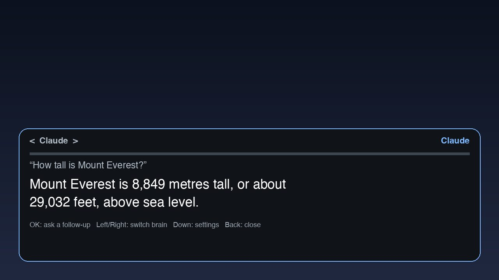

# Voice Assistant

Press the remote's mic button, ask a question out loud, and read (and hear) the answer from Claude or ChatGPT in
a compact dark panel over whatever is playing. For the [Clean Your TV](../../README.md) launcher it declares a
[module card](../../docs/modules.md), so once you answer **Show card** its tile reads "Voice Assistant"; on any
other Android TV home it is an ordinary app.

Built for TVs where Google Assistant is disabled, so Android's own `SpeechRecognizer` has no service: the
speech-to-text is an API call, not the system recognizer. Pick the service with the **Speech-to-text**
setting: `auto` (the default) uses Deepgram when its key is set and OpenAI otherwise, or force `deepgram` or `openai`.



## How it works

1. The panel opens and records at once: 16 kHz mono from `AudioSource.VOICE_RECOGNITION`, falling back to
   `MIC` when that source will not open or delivers only silence.
2. It stops after about 1.2 s of silence, at 15 s, or when you press OK. The level meter shows what the mic hears.
3. The WAV goes to Deepgram (`nova-3`) or OpenAI (`gpt-4o-mini-transcribe`) for speech-to-text, the text to the brain you chose, and the answer is shown
   in large type and spoken with the TV's text-to-speech. It answers in one to three short sentences.
4. The last 6 turns are kept while the panel is open, so follow-ups work. Closing it forgets them.

| Key | Does |
|---|---|
| OK | While listening: done. Otherwise: ask a follow-up (listen again) |
| Left / Right | Switch between Claude and ChatGPT |
| Down or Menu | Open settings |
| Back | Close |

Pressing the mic button again while it listens counts as OK.

## It shows up as the brain you connected

With Claude selected and its key set, the launcher tile (and the Clean Your TV card) reads "Claude" with its own
icon and banner; with ChatGPT selected and its key set, "ChatGPT"; otherwise "Voice Assistant". The overlay's
title shows the brain too. This is done with three `activity-alias` entries that all point at `.AssistActivity`
(`.LauncherDefault`, `.LauncherClaude`, `.LauncherChatGpt`), exactly one enabled at a time. `BrainIdentity.apply()`
switches them whenever the brain or a key changes (settings, `.SetupActivity`, Left/Right in the overlay), with
`PackageManager.setComponentEnabledSetting(..., DONT_KILL_APP)`, so no permission is needed. The launcher may take
a moment to redraw the tile. Each alias has its own card file (`module_card*.xml`); a changed card label makes
Clean Your TV ask once more whether to show it.

`.AssistActivity` itself stays the fixed target for the mic button and the assistant setting, whichever name the
tile has: `io.github.randomittin.voiceassistant/.AssistActivity`.

The art here is plain and drawn for this add-on: a sparkle (`icon_claude`, `banner_claude`) and a chat bubble
(`icon_chatgpt`, `banner_chatgpt`), never the companies' logos, which this repository does not accept. For a build
you keep to yourself you can swap those four drawables in `app/src/main/res/drawable/` (keep the names, 320x180 for the
banners) for whatever you are licensed to use, and build as usual.

## Opening it from the remote's mic button

The activity answers `android.intent.action.ASSIST`, `VOICE_COMMAND`, `android.speech.action.WEB_SEARCH` and
`android.intent.action.SEARCH_LONG_PRESS`, and has a Leanback launcher entry with a banner. A `WEB_SEARCH`
intent that carries a query goes straight to the brain without recording. If your TV's mic key does not reach it,
map the key to this activity in your launcher, or start it with:

```bash
adb shell am start -n io.github.randomittin.voiceassistant/.AssistActivity
```

## Keys and settings

Nothing is built in or committed: you bring your own API keys.

- **On the TV:** press Down in the panel, or open the settings activity, and fill in the Anthropic key (Claude)
  the Deepgram key and/or the OpenAI key (ChatGPT, and speech-to-text when Deepgram is not used). You need one of the
  two for speech-to-text; typed questions need neither. Keys are shown only as "set" or "not set".
- **Over ADB** (no typing with a remote), only the extras you pass are written, and a confirmation screen shows
  what was saved without echoing any key:

```bash
adb shell am start -n io.github.randomittin.voiceassistant/.SetupActivity \
  --es anthropic_key "$ANTHROPIC_API_KEY" --es deepgram_key "$DEEPGRAM_API_KEY" --es stt auto --es brain claude
```

Without extras, `.SetupActivity` just opens the settings screen. `openai_key` works the same way. `brain` is `claude` or `chatgpt`; `stt` is `auto`, `deepgram` or `openai`. The keys pass
through the adb shell's command line, so they can show up in its history on the TV; use a key you can revoke.

Without a Deepgram or an OpenAI key the panel says speech-to-text needs one and offers a typed question instead (OK, then the
TV's keyboard). Claude needs only the Anthropic key for typed questions, and ChatGPT only the OpenAI key.

Model ids are settings too:

| Setting | Default |
|---|---|
| Claude model | `claude-haiku-5-5` |
| ChatGPT model | `gpt-4o-mini` |
| Speech-to-text model (OpenAI) | `gpt-4o-mini-transcribe` |

Deepgram is called as `POST https://api.deepgram.com/v1/listen?model=nova-3&smart_format=true&detect_language=true`
with `Authorization: Token <key>` and the WAV as the body.

## Errors you may see

A wrong key shows "rejected the API key (401)"; an account out of credit shows 402 (Deepgram) or 429 (OpenAI); no network shows "No connection"; a slow API shows "took too
long"; a rate limit shows 429. A mic that delivers nothing shows "No audio from the remote mic"
with the source and level. Every recording logs its source and peak level for diagnosis:

```bash
adb logcat -s VoiceAssistant
```

## Permissions

| Permission | Why |
|---|---|
| `RECORD_AUDIO` | Records your question from the remote's mic. Asked for the first time you use it; recording only runs while the panel is on screen. |
| `INTERNET` | Sends the recording to Deepgram or OpenAI (whichever speech-to-text is in use) for transcription, and the conversation text to Anthropic or OpenAI (whichever brain is chosen). |

That is all. What is sent: the audio of one question to `api.deepgram.com` or `api.openai.com`, and the last 6 turns of text to
`api.anthropic.com` or `api.openai.com`. No account, no telemetry, no ads, no background service. Audio is kept in
memory only. Keys and settings stay in the app's own storage (backups are off). Using the APIs costs money on your
own accounts.

## Build and install

JDK 17 and Android SDK platform 34 with build-tools 34.0.0, as for the launcher:

```bash
cd addons/voice-assistant && ./gradlew assembleRelease
TV_HOST=<tv ip> ../../tools/venv/bin/python -I ../../tools/tv.py --push app/build/outputs/apk/release/app-release.apk /data/local/tmp/addon.apk
TV_HOST=<tv ip> ../../tools/venv/bin/python -I ../../tools/tv.py 'pm install -r /data/local/tmp/addon.apk; rm -f /data/local/tmp/addon.apk'
```

Unit tests (voice-activity detection, WAV header, multipart body, request JSON, response parsing):
`./gradlew testReleaseUnitTest`.

The release build is signed with the debug key so it installs over ADB like the launcher. Sign your own builds
with your own key if you hand them out.

## Tested on

Target: Android TV 10 (API 29), armeabi-v7a, 1.7 GB RAM, Bluetooth voice remote, Google Assistant disabled. Not
yet tested on a real TV: the pure logic is covered by unit tests, and the screenshot above is a drawing of the
panel, not a photo.

## Maintainer

[@randomittin](https://github.com/randomittin)
